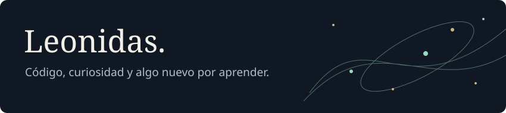

<a href="README.md">Español</a> · <strong>English</strong>

# Hi, I'm Leonidas

I'm **Thiago Sossa**, **[@leonidas854](https://github.com/leonidas854)** on GitHub. I work with C#, Python, Java and web technologies. I'm learning **Rust**, and my English level is **A2**.

[My interactive space](https://leonidas854.github.io/leonidas854/) · [Telegram](https://t.me/+59173902650) · [Discord](https://discord.gg/4DSrRk4CJS) · [Email](mailto:tsosachugar@gmail.com)

## What I work with

| Experience | Languages and technologies |
| :--- | :--- |
| Most used | **C# · Python · Java · TypeScript · JavaScript · SQL · HTML · CSS** |
| Currently learning | **Rust** |
| Basic knowledge | Go (Golang) · C++ · PHP · Dart |

### Frameworks and ecosystems

| Area | Technologies I use |
| :--- | :--- |
| Backend | ASP.NET · Spring Boot · Django · FastAPI · Laravel |
| Web | React · Next.js |
| Next.js deployment | OpenNext |
| Cross-platform | Flutter |
| Containers | Docker · Podman |
| Cloud — basic knowledge | AWS · Google Cloud |

## A little world of code and snow

A cabin for Rust, a house for Podman and a Go companion walking through the snow. Outside, a galaxy of particles. [Come in, move your cursor and shake the snow](https://leonidas854.github.io/leonidas854/).

## Let's talk about…

- C#, Java and Python; web applications and APIs.
- React, Next.js and building interfaces.
- Containers with Podman and Docker.
- Learning Rust and sharing programming questions.

**Languages:** Spanish · English A2.

My GitHub activity

<picture>
  <source media="(prefers-color-scheme: dark)" srcset="https://raw.githubusercontent.com/leonidas854/leonidas854/output/github-contribution-grid-snake-dark.svg">
  
</picture>

[View my contributions on GitHub](https://github.com/leonidas854).

## Get in touch

| Channel | Link |
| :--- | :--- |
| Telegram | [+591 73902650](https://t.me/+59173902650) |
| Discord | [Join the server](https://discord.gg/4DSrRk4CJS) |
| Email | [tsosachugar@gmail.com](mailto:tsosachugar@gmail.com) |

---

This profile is also an open repository. Adapt it using the [setup guide (Spanish)](SETUP_GUIDE.md). Code is released under the [MIT license](LICENSE); see [asset credits](CREDITS.md).
