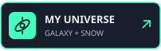
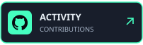

<!-- Generated by scripts/build.py; edit src/readme/en/. -->

<a href="README.md">Español</a> · <strong>English</strong>

<picture>
  <source media="(prefers-reduced-motion: reduce)" srcset="assets/profile/header-static.svg">
  
</picture>

<picture>
  <source media="(prefers-reduced-motion: reduce)" srcset="assets/profile/typing-static.svg">
  
</picture>

# Hi, I’m Leonidas

I’m **Thiago Sossa**, **[@leonidas854](https://github.com/leonidas854)**. I work with **C#, Python, Java and web technologies**. I’m learning **Rust**, and my English level is **A2**.

<picture>
  <source media="(prefers-reduced-motion: reduce)" srcset="assets/profile/terminal-static.svg">
  
</picture>

## What I work with

| Experience         | Languages and technologies                                          |
| :----------------- | :------------------------------------------------------------------ |
| Most used          | **C# · Python · Java · TypeScript · JavaScript · SQL · HTML · CSS** |
| Currently learning | **Rust**                                                            |
| Basic knowledge    | Go (Golang) · C++ · PHP · Dart                                      |

### Frameworks and ecosystems

| Area                    | Technologies I use                                 |
| :---------------------- | :------------------------------------------------- |
| Backend                 | ASP.NET · Spring Boot · Django · FastAPI · Laravel |
| Web                     | React · Next.js                                    |
| Next.js deployment      | OpenNext                                           |
| Cross-platform          | Flutter                                            |
| Containers              | Docker · Podman                                    |
| Cloud — basic knowledge | AWS · Google Cloud                                 |

## My universe: code and snow

<a href="https://leonidas854.github.io/leonidas854/">
<picture>
  <source media="(prefers-reduced-motion: reduce)" srcset="assets/profile/world-static.svg">
  
</picture>
</a>

A cabin for Rust, a house and a seal with a purple scarf for Podman, and a Go companion in the snow. [Open the 3D version to rotate the globe and shake the snow](https://leonidas854.github.io/leonidas854/).

## Let's talk about…

- C#, Java and Python; web applications and APIs.
- React, Next.js and building interfaces.
- Containers with Podman and Docker.
- Learning Rust and sharing programming questions.

**Languages:** Spanish · English A2.

## My GitHub contributions

<picture>
  <source media="(prefers-reduced-motion: reduce) and (prefers-color-scheme: dark)" srcset="https://raw.githubusercontent.com/leonidas854/leonidas854/output/github-contribution-grid-static-dark.svg">
  <source media="(prefers-reduced-motion: reduce)" srcset="https://raw.githubusercontent.com/leonidas854/leonidas854/output/github-contribution-grid-static.svg">
  <source media="(prefers-color-scheme: dark)" srcset="https://raw.githubusercontent.com/leonidas854/leonidas854/output/github-contribution-grid-snake-dark.svg">
  
</picture>

[View my full activity on GitHub](https://github.com/leonidas854?tab=overview). Updated daily.

## Get in touch

Spanish · English A2 Telegram: +591 73902650 · Email: tsosachugar@gmail.com

<a href="SETUP_GUIDE.md">Customize this profile</a> · <a href="LICENSE">MIT</a> · <a href="CREDITS.md">Credits</a>

