  <!-- Language selector -->
  

    <b>🌐 Language:</b>
    <a href="README.md"><b>Español 🇪🇸</b></a> |
    <a href="README.en.md"><b>English 🇬🇧</b></a>
  

  <!-- Animated Cosmic SVG Banner -->
  

    

  <!-- Dynamic Typing SVG -->
  

   

  <!-- Direct Contact Channels -->
  

    
    &nbsp;
    
    &nbsp;
    
    &nbsp;
    
  

<!-- ==================== PROFILE & TERMINAL ==================== -->

## 👨‍💻 Professional Profile

 

I am **Leonidas**, a software developer based in **Bolivia 🇧🇴**, focused on building reliable backend architectures, RESTful APIs, and end-to-end modern web applications.

My daily engineering centers around typed, resilient environments like **C# (.NET)**, **Java (Spring Boot)**, and **Python (FastAPI / Django)**, complemented on the client side by **TypeScript**, **React**, and **Next.js**. I work with containers using **Docker** and **Podman**, alongside foundational knowledge in cloud services from **AWS** and **Google Cloud Platform (GCP)**.

### 📌 Key Focus Areas:
- 💻 **Backend & Architecture:** Designing modular APIs, relational database integrations (PostgreSQL, MySQL, SQL Server), and decoupled domain logic.
- 🐳 **Containers & Environment:** Running and isolating services across Linux systems with **Docker** and **Podman**.
- 🦀 **Continuous Learning:** Delving into **Rust**, exploring its ownership model, memory safety guarantees without a garbage collector, and race-free concurrency.
- ☁️ **Cloud (Foundations):** Working knowledge of core cloud concepts and essential deployments in **AWS** and **Google Cloud**.
- 🗣️ **Languages:**
  - **Spanish:** Native.
  - **English:** **A2** level (actively studying and practicing technical reading and everyday conversational skills).

<!-- ==================== TECH STACK ==================== -->

## 🛠️ Tech Stack & Tooling

### 💎 Core Languages
> *Languages I actively engineer with:*

  

| Language | Primary Focus | Everyday Tooling & Ecosystem |
| :--- | :--- | :--- |
| **C#** | Resilient backend services, web APIs, microservices | ASP.NET Core, Entity Framework, LINQ |
| **Python** | Rapid services, automation scripts, data processing | FastAPI, Django, Pydantic, SQLAlchemy |
| **Java** | Enterprise services and structured object-oriented code | Spring Boot, Maven, Gradle, JPA |
| **TypeScript / JS** | Type-safe frontends and responsive web applications | React, Next.js, OpenNext.js, Node.js |
| **SQL** | Relational schemas, query optimization, indexing | PostgreSQL, MySQL, SQL Server |
| **HTML5 & CSS3** | Modern semantic layouts, accessible styling | Flexbox, CSS Grid, Tailwind CSS |

 

### ⚡ Frameworks & Libraries

  

- **Backend:** `ASP.NET Core` • `Spring Boot` • `FastAPI` • `Django` • `Laravel`
- **Frontend / Fullstack:** `React` • `Next.js` • `OpenNext.js`
- **Mobile / Cross-Platform:** `Flutter`

 

### 🐳 Containers, Cloud & Developer Tools

  

- **Containers & OS:** `Docker` • `Podman` • `Linux (Debian / Arch / Ubuntu)`
- **Cloud (Foundational Level):** `AWS` • `Google Cloud (GCP)`
- **Version Control & Workflows:** `Git` • `GitHub Actions` • `Postman`

 

### 🦀 Exploring & Secondary Stack
- 🦀 **Rust (Active Learning):** Compile-time memory verification without a runtime garbage collector, native system performance, and concurrency primitives.
- **Secondary Familiarity:** `Go (Golang)` • `C++` • `PHP` • `Dart`

<!-- ==================== VISUAL EXPERIMENT / SNOW GLOBE ==================== -->

## ❄️ Visual Showcase: Snow Globe & Cosmic Field

 

This repository incorporates an **interactive simulation in Three.js & Canvas** inspired by particle blizzard physics and cosmic gravitational vortex fields:
- 🌌 **Cosmic Nebula Field:** Multi-strand fluid dynamics with pointer interaction.
- ❄️ **Blizzard Simulation:** Wind-driven particle dynamics and drift patterns.
- 🔗 **Interactive Demo:** You can run the interactive simulation locally via [index.html](index.html) or visit the deployed version on [GitHub Pages](https://leonidas854.github.io/leonidas854/).

<!-- ==================== GITHUB ANALYTICS ==================== -->

## 📊 GitHub Analytics

  
  &nbsp;
  

    

  

<!-- ==================== CONTRIBUTION SNAKE ==================== -->

## 🐍 Contribution Activity

  <picture>
    <source media="(prefers-color-scheme: dark)" srcset="https://raw.githubusercontent.com/leonidas854/leonidas854/output/github-contribution-grid-snake-dark.svg">
    <source media="(prefers-color-scheme: light)" srcset="https://raw.githubusercontent.com/leonidas854/leonidas854/output/github-contribution-grid-snake.svg">
    
  </picture>

<!-- ==================== CONTACT ==================== -->

## 📬 Contact & Connect

If you'd like to collaborate, discuss technical topics, or share development insights, feel free to reach out through any of these channels:

  
  &nbsp;
  
  &nbsp;
  

