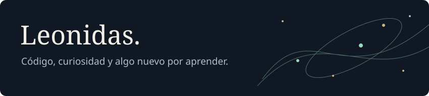

  <!-- Selector de idioma -->
  

    <b>🌐 Idioma:</b>
    <a href="README.md"><b>Español 🇪🇸</b></a> |
    <a href="README.en.md"><b>English 🇬🇧</b></a>
  

  <!-- Banner SVG Cósmico y Animado -->
  

    

  <!-- Efecto Typing SVG -->
  

   

  <!-- Canales de Contacto Directo -->
  

    
    &nbsp;
    
    &nbsp;
    
    &nbsp;
    
  

<!-- ==================== PERFIL & TERMINAL ==================== -->

## 👨‍💻 Perfil Profesional

 

Soy **Leonidas**, desarrollador de software con base en **Bolivia 🇧🇴**, enfocado en la construcción de servicios backend consistentes, APIs RESTful y aplicaciones web modernas de extremo a extremo.

Trabajo principalmente con ecosistemas tipados y robustos como **C# (.NET)**, **Java (Spring Boot)** y **Python (FastAPI / Django)**, complementados en el frontend con **TypeScript**, **React** y **Next.js**. Manejo contenedores con **Docker** y **Podman**, y cuento con fundamentos en servicios de nube de **AWS** y **Google Cloud Platform (GCP)**.

### 📌 Puntos Clave:
- 💻 **Backend & Arquitectura:** Diseño de APIs modulares, integración con bases de datos relacionales (PostgreSQL, MySQL, SQL Server) y lógica de negocio desacoplada.
- 🐳 **Contenedores & Entorno:** Despliegue de servicios en entornos Linux utilizando **Docker** y **Podman** para aislamiento seguro.
- 🦀 **En Aprendizaje:** Profundizando en **Rust**, estudiando el modelo de propiedad (*ownership*), concurrencia sin condiciones de carrera y rendimiento a bajo nivel.
- ☁️ **Cloud (Fundamentos):** Conceptos básicos y despliegues elementales en **AWS** y **Google Cloud**.
- 🗣️ **Idiomas:**
  - **Español:** Nativo.
  - **Inglés:** Nivel **A2** (en estudio activo y práctica constante orientada a lectura técnica y comunicación conversacional).

<!-- ==================== TECH STACK ==================== -->

## 🛠️ Tecnologías & Herramientas

### 💎 Lenguajes Principales
> *Lenguajes con los que desarrollo habitualmente:*

  

| Lenguaje | Áreas Habituales | Herramientas / Ecosistema |
| :--- | :--- | :--- |
| **C#** | Servicios backend, APIs empresariales, microservicios | ASP.NET Core, Entity Framework, LINQ |
| **Python** | Microservicios rápidos, scripts, procesamiento y APIs | FastAPI, Django, Pydantic, SQLAlchemy |
| **Java** | Arquitecturas empresariales y servicios modulares | Spring Boot, Maven, Gradle, JPA |
| **TypeScript / JS** | Interfaces web dinámicas y desarrollo tipado | React, Next.js, OpenNext.js, Node.js |
| **SQL** | Diseño de esquemas relacionales, optimización de consultas | PostgreSQL, MySQL, SQL Server |
| **HTML5 & CSS3** | Maquetación web moderna, semántica y responsiva | Flexbox, CSS Grid, Tailwind CSS |

 

### ⚡ Frameworks & Librerías

  

- **Backend:** `ASP.NET Core` • `Spring Boot` • `FastAPI` • `Django` • `Laravel`
- **Frontend / Fullstack:** `React` • `Next.js` • `OpenNext.js`
- **Móvil / Multiplataforma:** `Flutter`

 

### 🐳 Contenedores, Nube & Herramientas

  

- **Contenedores & OS:** `Docker` • `Podman` • `Linux (Debian / Arch / Ubuntu)`
- **Cloud (Nivel Básico / Fundamentos):** `AWS` • `Google Cloud (GCP)`
- **Versionado & Flujo:** `Git` • `GitHub Actions` • `Postman`

 

### 🦀 Aprendizaje Activo & Otros Lenguajes
- 🦀 **Rust (En aprendizaje activo):** Gestión estricta de memoria sin garbage collector, compilación nativa y concurrencia segura.
- **Conocimientos Secundarios:** `Go (Golang)` • `C++` • `PHP` • `Dart`

<!-- ==================== EXPERIMENTO VISUAL / ESFERA DE NIEVE ==================== -->

## ❄️ Bola de Nieve & Campo Cósmico

 

Visualización y simulación interactiva con física de partículas, ventisca invernal y campo cósmico:
- 🦀 **Cabaña Rust & Laboratorio Podman:** Desarrollo de sistemas concurrentes y contenedores aislados.
- 🐹 **Golang Gopher:** Microservicios y servicios concurrentes de alta velocidad.
- 🌌 **Campo de Partículas:** Filamentos y vórtices interactivos en tiempo real.
- 🔗 **Acceso en Vivo:** Puedes interactuar con la simulación completa abriendo [index.html](index.html) o visitando la versión desplegada en [GitHub Pages](https://leonidas854.github.io/leonidas854/).

<!-- ==================== ESTADÍSTICAS DINÁMICAS ==================== -->

## 📊 Estadísticas de GitHub

  
  &nbsp;
  

    

  

<!-- ==================== SERPIENTE DE CONTRIBUCIONES ==================== -->

## 🐍 Historial de Contribuciones

  <picture>
    <source media="(prefers-color-scheme: dark)" srcset="https://raw.githubusercontent.com/leonidas854/leonidas854/output/github-contribution-grid-snake-dark.svg">
    <source media="(prefers-color-scheme: light)" srcset="https://raw.githubusercontent.com/leonidas854/leonidas854/output/github-contribution-grid-snake.svg">
    
  </picture>

<!-- ==================== CONTACTO ==================== -->

## 📬 Contacto

Si deseas colaborar en un proyecto, tienes consultas técnicas o buscas intercambiar ideas de desarrollo, puedes escribirme a través de cualquiera de estos canales:

  
  &nbsp;
  
  &nbsp;
  

