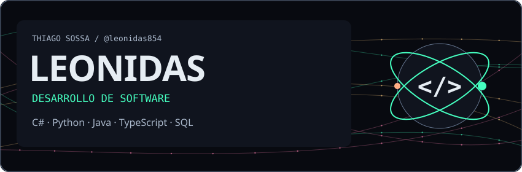
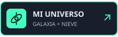
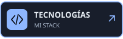
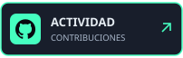

<!-- Generated by scripts/build.py; edit src/readme/es/. -->

<strong>Español</strong> · <a href="README.en.md">English</a>

<picture>
  <source media="(prefers-reduced-motion: reduce)" srcset="assets/profile/header-static.svg">
  
</picture>

<picture>
  <source media="(prefers-reduced-motion: reduce)" srcset="assets/profile/typing-static.svg">
  
</picture>

# Hola, soy Leonidas

Soy **Thiago Sossa**, **[@leonidas854](https://github.com/leonidas854)**. Trabajo con **C#, Python, Java y tecnologías web**. Estoy aprendiendo **Rust** y mi nivel de inglés es **A2**.

<picture>
  <source media="(prefers-reduced-motion: reduce)" srcset="assets/profile/terminal-static.svg">
  
</picture>

## Con qué trabajo

| Experiencia            | Lenguajes y tecnologías                                             |
| :--------------------- | :------------------------------------------------------------------ |
| Donde más he trabajado | **C# · Python · Java · TypeScript · JavaScript · SQL · HTML · CSS** |
| Estoy aprendiendo      | **Rust**                                                            |
| Conocimientos básicos  | Go (Golang) · C++ · PHP · Dart                                      |

### Frameworks y ecosistemas

| Área                         | Tecnologías que utilizo                            |
| :--------------------------- | :------------------------------------------------- |
| Backend                      | ASP.NET · Spring Boot · Django · FastAPI · Laravel |
| Web                          | React · Next.js                                    |
| Despliegue de Next.js        | OpenNext                                           |
| Multiplataforma              | Flutter                                            |
| Contenedores                 | Docker · Podman                                    |
| Nube — conocimientos básicos | AWS · Google Cloud                                 |

## Mi universo: código y nieve

<a href="https://leonidas854.github.io/leonidas854/">
<picture>
  <source media="(prefers-reduced-motion: reduce)" srcset="assets/profile/world-static.svg">
  
</picture>
</a>

Rust tiene su cabaña, Podman su casa y Go un compañero en la nieve. [Abre la versión 3D para girar la esfera y agitar la nieve](https://leonidas854.github.io/leonidas854/).

## Podemos hablar de…

- C#, Java y Python; aplicaciones web y APIs.
- React, Next.js y el desarrollo de interfaces.
- Contenedores con Podman y Docker.
- Aprender Rust e intercambiar dudas de programación.

**Idiomas:** español · inglés A2.

## Mis contribuciones en GitHub

<picture>
  <source media="(prefers-reduced-motion: reduce) and (prefers-color-scheme: dark)" srcset="https://raw.githubusercontent.com/leonidas854/leonidas854/output/github-contribution-grid-static-dark.svg">
  <source media="(prefers-reduced-motion: reduce)" srcset="https://raw.githubusercontent.com/leonidas854/leonidas854/output/github-contribution-grid-static.svg">
  <source media="(prefers-color-scheme: dark)" srcset="https://raw.githubusercontent.com/leonidas854/leonidas854/output/github-contribution-grid-snake-dark.svg">
  
</picture>

[Ver mi actividad completa en GitHub](https://github.com/leonidas854?tab=overview). Se actualiza cada día.

## Hablemos

Español · Inglés A2 Telegram: +591 73902650 · Correo: tsosachugar@gmail.com

<a href="SETUP_GUIDE.md">Personalizar este perfil</a> · <a href="LICENSE">MIT</a> · <a href="CREDITS.md">Créditos</a>

